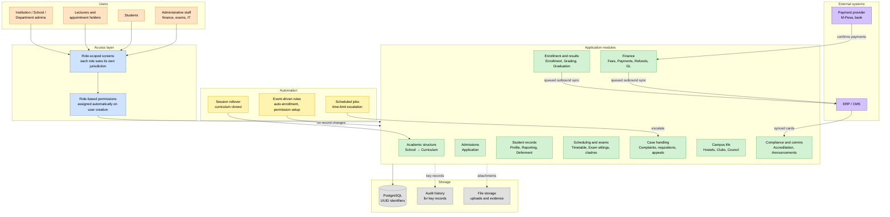
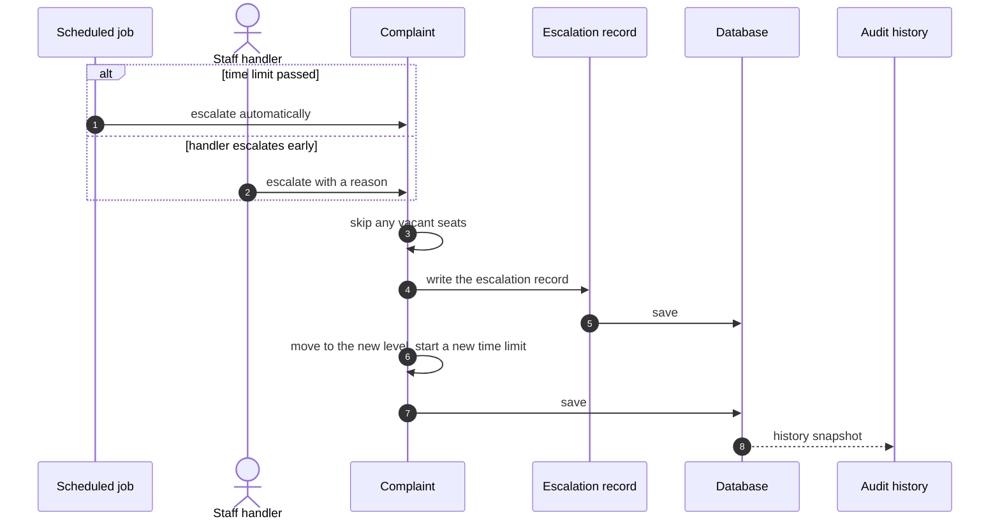

# 🏗️ Architecture Overview

> The big picture: how all the layers of the system fit together.

> 🕒 Last updated: 2026-10-16

---

## 🗺️ System Map

Requests flow top to bottom through scoped access into the modules, which
persist to the database. Automation and external systems feed back into the
modules from the side.



---

## 🔁 Anatomy of a workflow action

Workflow actions all follow one pattern: check the rules, record who did it
and why, save, and keep an audit trail. Escalating a complaint shows it well.



At the last level of a ladder, an automatic escalation does not move the case.
It only raises the priority.

---

## 📦 Module Breakdown

### 🎓 Academic structure

```
School
└── Department
    ├── Course
    ├── Lecturer
    └── Programme
        ├── Syllabus (Programme + Course)
        └── Tclass (cohort)
            └── Curriculum (Tclass + Syllabus + Session, taught by Lecturers)
```

### 📥 Admissions

```
Application          per Programme and Session
├── Supporting documents
└── Transfer credit evaluation   maps to a Course (optional)
Application accepted  →  Student record created
```

### 👤 Student records

```
Student              personal profile
├── Parent / guardian, emergency contacts, ID card
├── Medical profile → clinic encounters
├── Reporting        check-in per session
├── Deferment        deferred-from and returning-to sessions
└── Status change requests
```

### 📋 Enrollment, results & graduation

```
Enrollment           Student ↔ Curriculum (explicit record)
└── Result           CAT / Exam / Assignment, with a release state
Grading              one set of rules turns results into grades
DegreeAudit          credits and GPA vs programme requirement
Graduation → Diploma, Convocation
```

See [Grading & Results](modules/academics/index.md).

### 💰 Finance

```
FeeStructure (+ items)   what a class owes per session
StudentFeeAccount        per-student ledger, balance derived
Payment / Charge / Refund / Scholarship award
Journal entries          GL postings for payments and refunds
```

### 🕐 Scheduling & exams

```
Timetable            Curriculum + Venue + time slot
Daily class records  per-session sign-off and reschedules
Exam sittings        per Curriculum → venues → invigilators
Exam clashes         detected across all sittings
Exam cards           issued per student per session
```

### 🗂️ Case handling

```
Complaints           routed by category, escalated by time limit
Appeals              against closed decisions, within a window
Requisitions         resit, supplementary, remark, special exam
Staff inbox          each case belongs to whoever holds its level
```

See [Case Handling](modules/casework/index.md).

### 📣 Everything else

| Area                  | Models                                                    | ER section |
| --------------------- | --------------------------------------------------------- | ---------- |
| Complaints & appeals  | `Complaint`, `ComplaintAppeal`, `ComplaintNote`           | §7         |
| Academic requisitions | `AcademicRequisition`, `RequisitionDocument`              | §17        |
| Hostels               | `Hostel`, `Room`, `HostelAllocation`                      | §12        |
| Clubs                 | `Club`, `ClubMembership`, `ClubEvent`, `ClubBudget`       | §13        |
| Student council       | `CouncilTerm`, `Election`, `CouncilProposal`              | §14        |
| Compliance            | `Accreditation`, `RegulatoryReport`, `RegistrationWindow` | §15        |
| Communications        | `Announcement`, `NewsItem`, `EventItem`                   | §16        |

---

## 🔑 Key Design Decisions

| Decision                         | Reason                                                                                                           |
| -------------------------------- | ---------------------------------------------------------------------------------------------------------------- |
| 🔑 UUID identifiers              | Security: no sequential IDs exposed in URLs                                                                      |
| 🗓️ Institution-wide session      | All time-bound modules reference one active session                                                              |
| 📋 Curriculum as the hub         | The same course can have different lecturers, schedules and results per class and session                        |
| ⚡ Event-driven enrollment       | Decouples student creation from enrollment logic                                                                 |
| 🎯 One grading rulebook          | Every screen and transcript shows the same grade, because none calculates its own                                |
| 💰 Derived balances              | Account balance is computed from payments, charges, awards and refunds, never stored                             |
| 🧊 Frozen snapshots              | Grades, complaint scores and appealed decisions are recorded as they stood, so later edits can't rewrite history |
| ⏱️ Per-category escalation rules | Each complaint category has its own ladder and time limits; vacant seats are skipped                             |
| 🔌 Queued ERP sync               | Slow or flaky external systems never block a student-facing request                                              |
| 🧾 Audit history                 | Key records keep a full change history                                                                           |
| 🔒 Scoped access                 | Each role sees only its own jurisdiction                                                                         |

---

> 🔗 See the [ER Diagram](er-diagram.md) for the full database schema
> 🔗 See [Workflows](workflows.md) for role-by-role flows
> 🔗 Back to [Project Index](../README.md)
> 🔗 Back to [Documentation Index](./README.md)
