# 🗃️ Database Schema

> The full entity relationship diagram for Naet
> Every table, every relationship, all in one place.

> 🕒 Last updated: 2026-10-16

---

## 📊 ER Diagram

## 1. Core identity & staff

`User` is the single account table. Every specialised staff role is its own
profile hanging off `User`, with no shared staff base table.

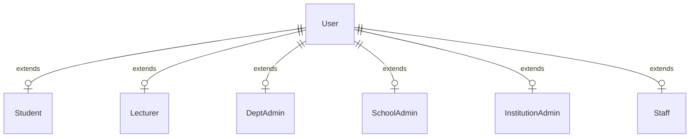

## 2. Institutional hierarchy

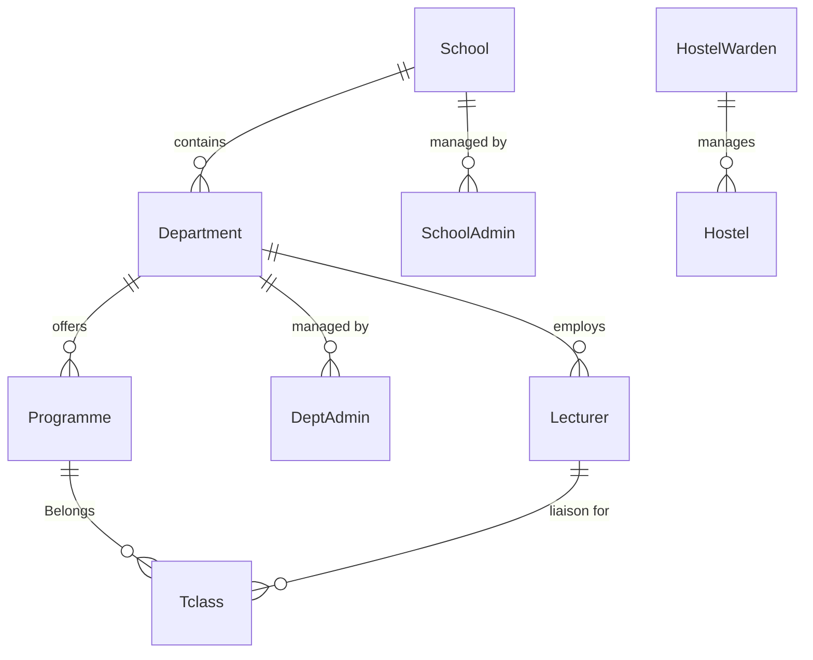

## 3. Admissions pipeline

The stage before a `Student` record exists. An `Application` is promoted into
a `Student` once it is marked enrolled.

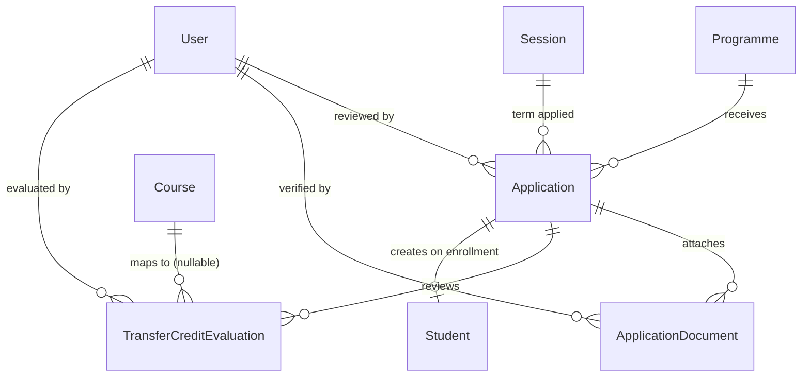

## 4. Academic — curriculum, enrollment, results & evaluations

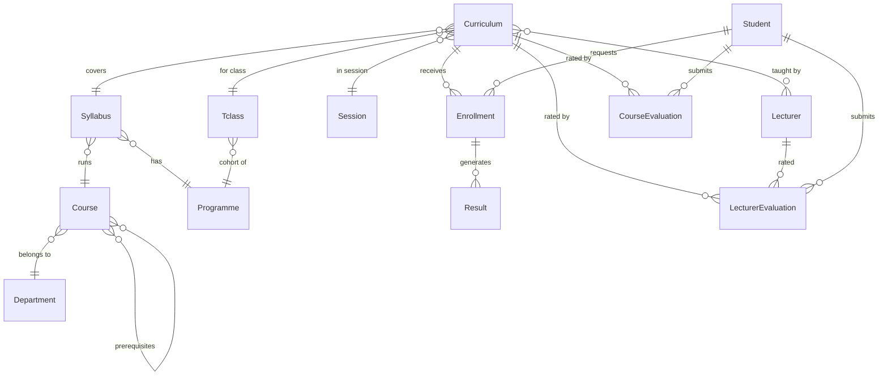

## 5. Sessions, reporting & deferment

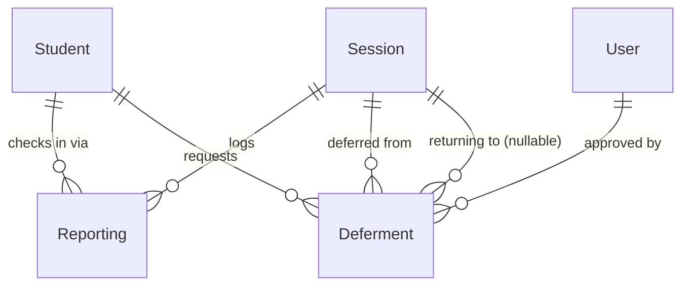

## 6. Student profile extensions

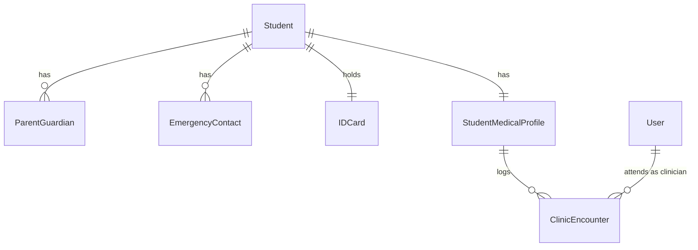

## 7. Complaints, appeals & status changes

A results dispute links the complaint to the unit registration (and
optionally one specific result) being challenged. Other categories carry no
result reference. An escalation made by the system rather than a person has
no escalating user.

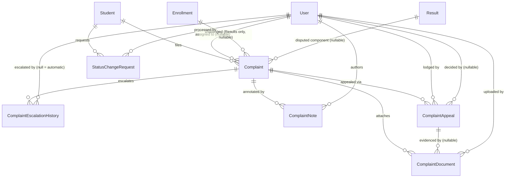

## 8. Degree audit & graduation

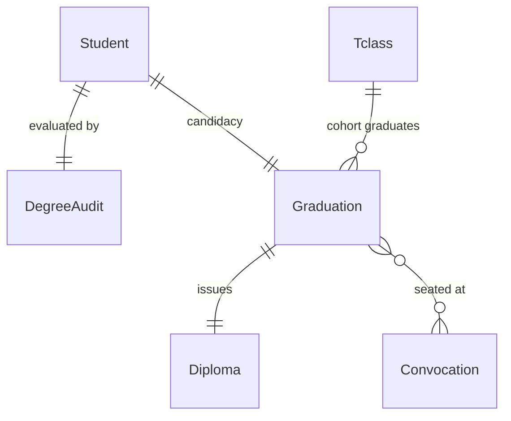

## 9. Finance — fees & payments

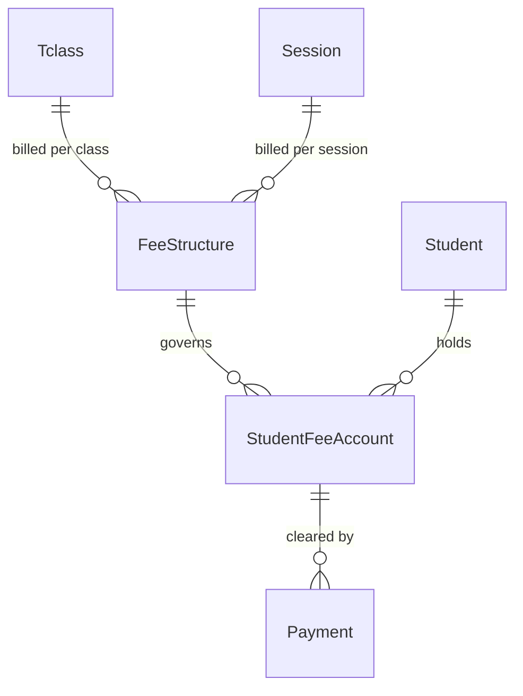

## 10. Campus infrastructure & class scheduling

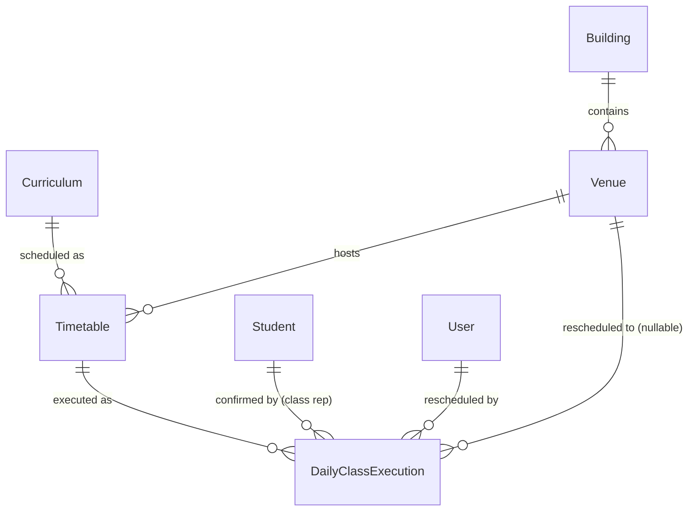

## 11. Examinations & invigilation

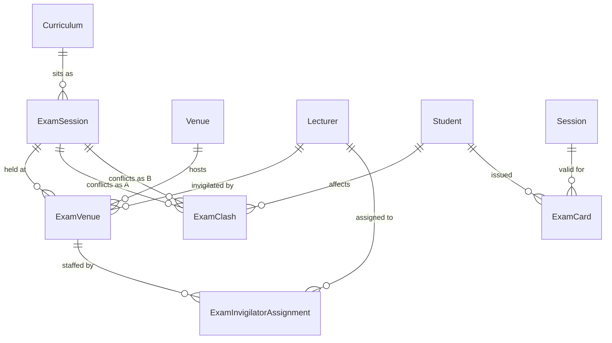

## 12. Hostels & housing

`HostelListing` is a student-facing off-campus housing directory. It has no
relationship to the on-campus `Hostel` / `Room` / `HostelAllocation` chain,
so it's drawn standalone.

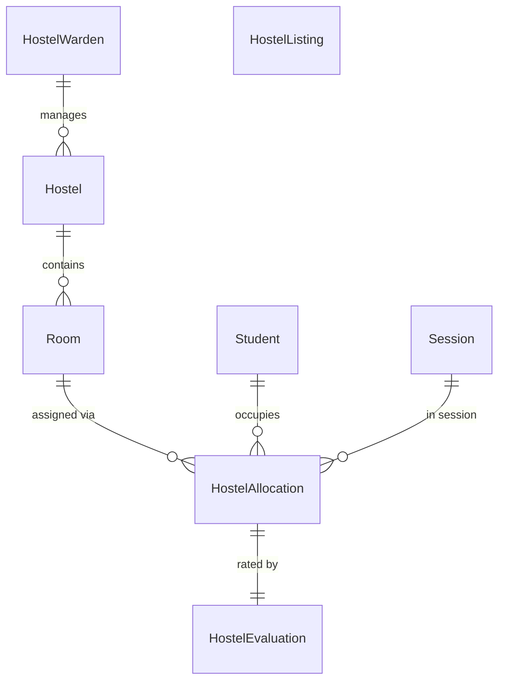

## 13. Clubs & societies

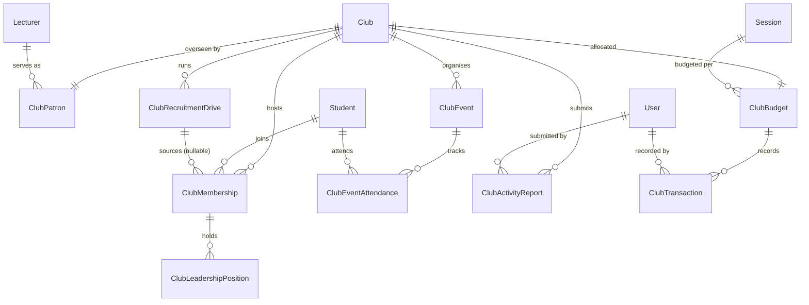

## 14. Student council & governance

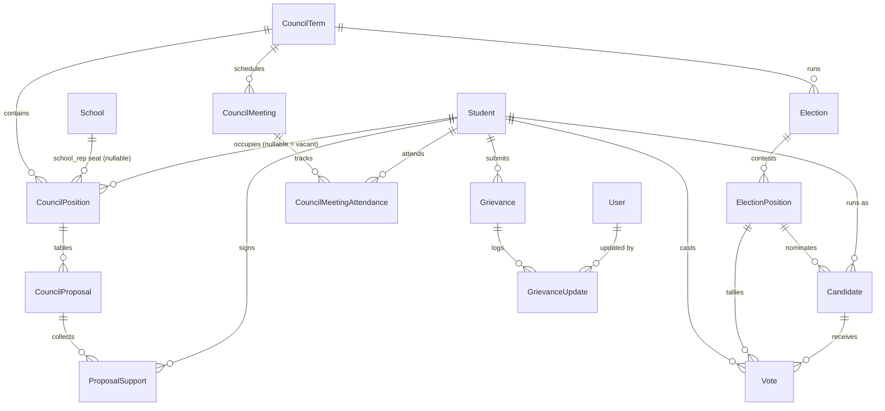

## 15. Compliance & regulatory

`ComplianceCalendarEvent` is a derived calendar view over the three
deadline-bearing tables below. It is always built from them, never entered
by hand.

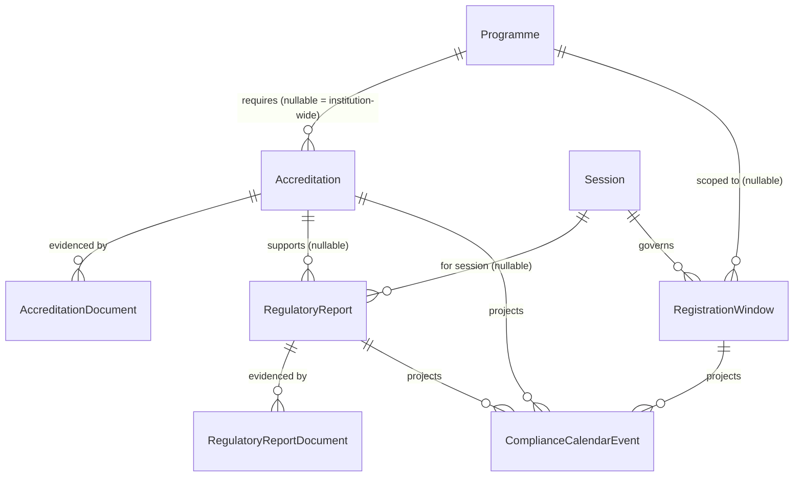

## 16. Communications & broadcast

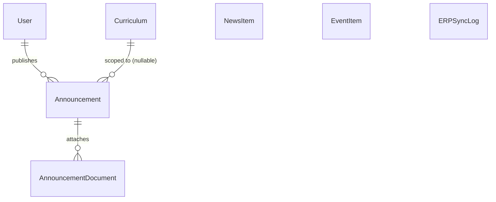

`NewsItem`, `EventItem` and `ERPSyncLog` are standalone. They hold card data
synced from an external CMS or ERP, and have no internal relationships.

## 17. Academic requisitions (resit, supplementary, remark, special exam)

Student-initiated requests against a single unit registration. A request names
a specific result only when it is a re-evaluation, and registers against a
formal exam sitting only when it is a resit or supplementary. Once completed,
a request points at the result that reflects its final outcome.

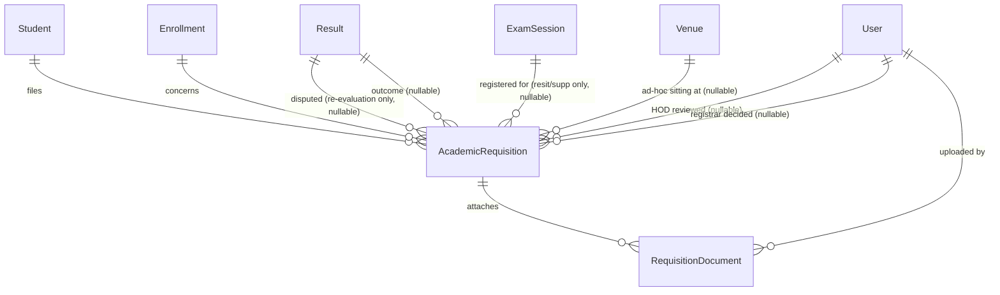

Request types: resit, supplementary, missing marks, special exam, re-evaluation.

---

## 🔑 Key Relationships Explained

**👤 User → Profiles**
Every user has exactly one profile depending on role. A student user gets a
`Student` profile, a staff user becomes a `Lecturer`, `ItStaff`,
`FinanceStaff` and so on, and an admin user becomes a `DeptAdmin`,
`SchoolAdmin` or `InstitutionAdmin`.

**🎓 Student → Class → Programme → Department → School**
The full academic hierarchy. A student belongs to a class, which belongs to a
programme, which belongs to a department, which belongs to a school.

**📋 Curriculum is the hub, not Course/Tclass directly**
Enrollment, Result, Timetable, ExamSession and both evaluation models all hang
off `Curriculum` (the course + class + session junction) rather than off
`Course` or `Tclass`. This is what lets the same course carry different
lecturers, schedules and results per class per session. `AcademicRequisition`
hangs off `Enrollment`, so it always refers to one student's registration for
one unit.

**💰 Fee flow**
`FeeStructure` defines what a class owes per session →
`StudentFeeAccount` is the per-student ledger →
`Payment` records individual transactions.

**⚖️ Complaints reach into results**
A results complaint points at the enrollment (and optionally one result) being
challenged, which is how a dispute can hold marks and show reviewers exactly
what was contested.

**🏛️ Clubs vs. Council**
Both are student-organisation trees with the same shape (membership →
leadership → events → budget), but they're independent hierarchies. `Club` is
opt-in and per-society, while `CouncilTerm` is the single campus-wide
governing body elected via `Election`.

---

> 🔗 Back to [Project Index](../README.md)
> 🔗 Back to [Documentation Index](./README.md)
