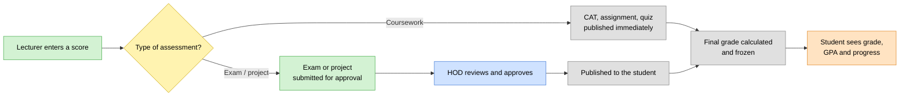
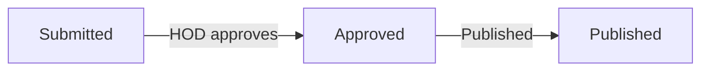
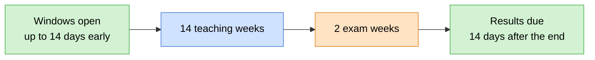

# 🎯 Grading & Results

> How coursework and exam scores become a grade, how those results are approved
> and released, and how grades roll up into GPA, classification and progression.
> One set of rules, applied the same way on every screen.

> 🕒 Last updated: 2026-10-16

---

## 🗺️ At a Glance

Every number a student, lecturer, HOD or registrar sees about a result comes
from the same grading rules. The lecturer's marking page, the class list, the
student's results page and the transcript can't disagree, because none of them
calculates a grade on its own.

| Principle                    | What it means in practice                                                     |
| ---------------------------- | ----------------------------------------------------------------------------- |
| 🧮 One formula               | Every unit is graded the same way: weighted components, then a grade band     |
| 🚫 No partial numbers        | If any component is missing, the unit shows "in progress", never a half-score |
| 🧊 Grades are frozen         | Once a grade is finalised it keeps the scale and pass mark used at the time   |
| 👁️ Release before reveal     | Students only see results once they have been approved and published          |
| ✅ Exam results are approved | Exam and project marks need HOD sign-off before students can see them         |

---

## 🛤️ The Journey of a Result

A lecturer can also **lock and transmit** a unit once all components are in.
That freezes the grade early, but students still see nothing until the exam
and project results have been approved and published.

---

## 🧮 How a Final Grade Is Calculated

Each course has a **weighting scheme**, for example 30% coursework and 70%
exam, and a **grading scale** that maps scores to letter grades and grade
points.

1. **Each component is scored on its own rules.** A component may take the best N attempts, the latest N, or apply a cap, depending on how the lecturer configured it.
2. **Components are combined by weight** into a single score, rounded to two decimal places.
3. **The score is placed in a grade band**, which gives the letter and the grade points.
4. **The pass mark decides pass or fail.** A pass earns the course's credits.

If any component isn't complete yet, the unit has no score at all and shows
as **in progress**. A student never sees a partial total.

| Outcome       | Meaning                                                            |
| ------------- | ------------------------------------------------------------------ |
| `pass`        | Score is at or above the course pass mark; credits are earned      |
| `fail`        | Score is below the pass mark; no credits                           |
| `in_progress` | Not enough results yet, or results not yet released to this viewer |

---

## 📝 The Assessment Plan

For each unit, the lecturer sets up an **assessment plan** describing how many
assessments are expected per component, the maximum score for each, and how
they are combined.

| Rule               | Detail                                                                      |
| ------------------ | --------------------------------------------------------------------------- |
| Who can edit       | Only the unit's **primary** lecturer; a substituted lecturer can't          |
| What can be edited | Expected count, maximum score, aggregation method, and N for best/latest-N  |
| When it locks      | Once any results have been submitted for the unit, or any student is graded |

Locking keeps the rules from changing after marks exist, so a grade can always
be explained by the plan that was in force when it was earned.

---

## 👁️ Result States & Who Sees What

| State       | Meaning                                        | Lecturer | Student |
| ----------- | ---------------------------------------------- | :------: | :-----: |
| `submitted` | Exam or project entered, awaiting HOD approval |    ✅    |   ❌    |
| `approved`  | HOD has signed off, not yet released           |    ✅    |   ❌    |
| `published` | Live                                           |    ✅    |   ✅    |
| `disputed`  | On hold while a results complaint is open      |    ✅    |   ❌    |

Coursework types are published as soon as they are entered. Exam and project
results follow the full path.

---

## 🧊 Frozen Grades

When a grade is finalised, the system stores:

- the final score, grade points and credits earned,
- the grading scale, weighting scheme and pass mark that were applied.

Later changes to a scale or pass mark therefore never rewrite a grade that has
already been awarded, and a transcript always reads the same.

A frozen grade is **held back from students** until every result that fed it
has been published. Until then the unit shows as in progress.

---

## ✅ Approval & Publishing

Exam and project results are approved **per unit** by the HOD of the course's
department.

- Only an active HOD of the department that owns the course can approve.
- Approval also certifies the unit's result submission.
- Publishing can happen in the same step or later.
- On publishing, any student not yet graded has their grade finalised.
- A configuration problem on one unit is reported and **doesn't block** the rest from being published.

---

## 🎓 GPA, Classification & Progression

All of these are calculated centrally from graded units. In-progress units are
ignored.

| Measure     | Rule                                                                            |
| ----------- | ------------------------------------------------------------------------------- |
| GPA         | Σ (grade points × credits) ÷ credits, to two decimal places. Failed units count |
| CGPA        | Same, but a retake **replaces** the earlier attempt at that course              |
| Progression | Requires a GPA of at least **2.00** and **no failed units**                     |

| CGPA at least | Classification               |
| ------------- | ---------------------------- |
| 3.6           | First Class Honours          |
| 3.0           | Second Class Honours (Upper) |
| 2.5           | Second Class Honours (Lower) |
| 2.0           | Pass                         |
| below 2.0     | Probation                    |

These feed degree audit and the graduation track.

---

## ⚖️ Disputing a Result

A student who believes a mark is wrong files a results complaint against the
unit. While it is open, the disputed results are placed on hold. The case is
reviewed by the lecturer who entered the score, then moves up the ladder if
unresolved. See [Case Handling](casework.md) for how staff work these cases and
[Workflows §3](../workflows.md) for the routing and time limits.

Closing a complaint lifts the hold but does not change any marks. A corrected
mark goes through a formal regrade.

---

## 🗓️ The Session Calendar

A session is **14 teaching weeks** followed by **2 exam weeks**, starting on a
Monday and ending on a Friday. Results are due **14 days** after the session
ends.

Each registration window opens and closes at a set offset from the session
start (or the exam start or end), so a new session gets a consistent calendar.
Some windows also allow late entry.

| Window               | Opens                | Closes                | Late entry until |
| -------------------- | -------------------- | --------------------- | ---------------- |
| Reporting            | 14 days before start | 7 days after start    | 14 days after    |
| Course registration  | 14 days before start | 14 days after start   | 21 days after    |
| Fee payment          | 14 days before start | 28 days after start   | 42 days after    |
| Hostel               | 14 days before start | 7 days after start    | —                |
| Bursary              | 14 days before start | 21 days after start   | 35 days after    |
| Scholarship          | 14 days before start | 14 days after start   | —                |
| Club membership      | 7 days after start   | 28 days after start   | —                |
| Election nominations | 14 days after start  | 28 days after start   | —                |
| Election             | 35 days after start  | 42 days after start   | —                |
| Graduation candidacy | Start                | 30 days after start   | —                |
| Course evaluations   | 14 days before exams | Exams start           | —                |
| Exam registration    | 28 days before exams | 7 days before exams   | —                |
| Result submissions   | Exams start          | Results deadline      | —                |
| Backlog exams        | 7 days after the end | 21 days after the end | —                |

---

## 🔗 Where to Go Next

| Topic                                 | Document                       |
| ------------------------------------- | ------------------------------ |
| 🗂️ How staff handle results disputes  | [Case Handling](casework.md)   |
| 🔄 Results, graduation and exam flows | [Workflows](../workflows.md)   |
| 🗃️ Data model                         | [ER Diagram](../er-diagram.md) |

---

> 🔗 Back to [Documentation Index](../README.md)
