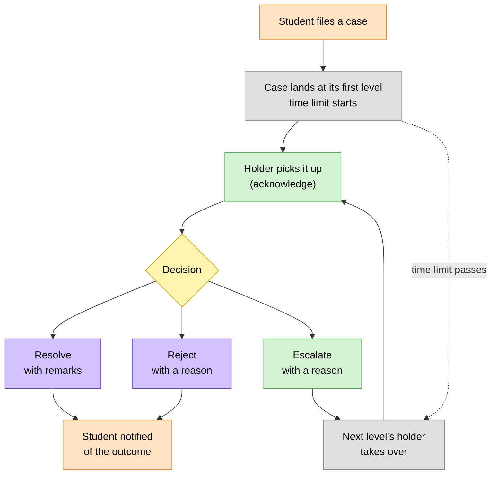

# 🗂️ Case Handling

> How staff work the complaints and grievances that reach them: who a case goes
> to, what they can do with it, how privacy is protected, and what happens when
> time runs out.
> The student files; this is the staff side.

> 🕒 Last updated: 2026-10-16

---

## 🗺️ At a Glance

Every case sits at **one level** at a time, such as the result entrant, the
programme liaison, or the Head of Department. Only the person who holds that
level for that case can act on it. When they escalate, the case moves on and
belongs to the next holder. The previous holder keeps a read-only record.

---

## 🧭 Levels & Who Holds Them

| Level                               | Who holds the case                                                 | Status       |
| ----------------------------------- | ------------------------------------------------------------------ | ------------ |
| Result entrant                      | The lecturer who entered the disputed score                        | ✅ Available |
| Programme liaison                   | The lecturer who is liaison for the student's class                | ✅ Available |
| Head of Department                  | The active HOD of the department that runs the student's programme | ✅ Available |
| Dean                                | The active Dean of the school                                      | 🔜 Planned   |
| Student council seats               | School representative, secretary general, deputy chair and chair   | 🔜 Planned   |
| Dean of Students, Registrar, Senate | Higher tiers of the escalation ladders                             | 🔜 Planned   |

Holding is always decided by who currently fills the role. If a seat is vacant,
the case skips past it to the next level that is actually held.

Each complaint category has its own ladder and time limits. See
[Workflows §3](../../workflows.md) for the full ladders. Faculty-level handling is
available today for **Results** and **Academic** complaints; the
Facilities, Administrative, Catering and General ladders run through the
student council and Dean of Students, which are coming next.

---

## 📥 The Inbox

| Tab          | Contains                                                                    |
| ------------ | --------------------------------------------------------------------------- |
| **My cases** | Open cases at a level the user holds right now                              |
| **History**  | Cases the user previously held, escalated, wrote a note on, or was assigned |

Cases are ordered by deadline, soonest first. Staff can filter by status,
priority and category, and search by subject, description, or (for
non-anonymous cases only) the student's name or registration number.

A summary strip shows what needs attention:

| Count       | Meaning                               |
| ----------- | ------------------------------------- |
| Awaiting    | Cases waiting on you                  |
| Overdue     | Cases past their time limit           |
| In progress | Cases you have picked up              |
| Resolved    | Cases you handled that are now closed |

A closed case that was rejected shows as **Rejected** rather than Resolved.

---

## 🎬 What Staff Can Do

| Action          | Who                                   | What happens                                                                            |
| --------------- | ------------------------------------- | --------------------------------------------------------------------------------------- |
| **Add a note**  | Any holder                            | Adds an internal remark, or one the student can see                                     |
| **Acknowledge** | Any holder                            | Status becomes _In progress_; the case is assigned to you; the student sees "picked up" |
| **Resolve**     | Any holder                            | Closes the case with written remarks; the student is told the outcome                   |
| **Reject**      | Holders at Department level and above | Closes the case with a written reason; the marks or decision stand                      |
| **Escalate**    | Any holder, if there is a next level  | Moves the case up with a recorded reason; assignment is cleared                         |

Liaisons and result entrants can resolve or escalate, but not reject. Rejection
is reserved for senior levels. Resolution remarks and rejection reasons must
be written out, so every closed case has an explanation on file.

---

## 🔍 What Staff See on a Case

- **Summary**: reference number, subject, category, priority, status, current level, deadline and whether it is overdue.
- **Student details**: name, registration number, class and programme, unless the case is anonymous.
- **Description and supporting documents** uploaded by the student.
- **Results disputes** also show the unit, session and credits, the lecturers, the exact marks **as they stood when the student filed** (CAT, exam, total, grade), and the marks as they are now.
- **Timeline**: every escalation (manual or automatic) and every note, in order, with who did it and when.

Seeing the marks at filing time matters: a case escalated to a senior reviewer
still shows what was actually disputed, even if the score has since been
corrected.

---

## 🔒 Privacy

| Principle                           | How it works                                                                                                           |
| ----------------------------------- | ---------------------------------------------------------------------------------------------------------------------- |
| Harassment is handled separately    | Harassment complaints go straight to the Dean of Students and never appear in faculty inboxes                          |
| Anonymous complaints stay anonymous | Faculty see "Anonymous student" with no registration number, class or programme; search can't be used to identify them |
| Students see what's meant for them  | System messages and any note marked student-visible appear in the student's history; other notes stay internal         |
| Access follows the level            | Staff who don't hold a case, and never handled one, can't open it                                                      |

---

## ⏱️ Time Limits & Automatic Escalation

Every level has a time limit, set per category. If the holder hasn't resolved
the case when it runs out, the system escalates it automatically, raises its
priority one step, and starts the next level's clock. The timeline shows these
as _System (SLA expired)_. A manual escalation records who moved it and why.

At the final level of a ladder a case can't move further. If its time limit
passes there, only the priority is raised.

---

## ⚖️ Results Disputes

A results complaint puts the disputed marks **on hold** while the case is open.

- **The result entrant reviews first**, since a data-entry slip is the quickest thing to fix.
- **Closing a case lifts the hold**, unless another dispute on the same unit is still open.
- **Closing never changes marks.** A corrected score goes through the formal regrade process, and the grading rules in [Grading & Results](../academics/index.md) apply from there.
- **Resolve or reject**: a rejected case ends as _Resolved_ with the outcome _Rejected_, and the original marks stand.

---

## 🙋 Appeals

A student can appeal a closed decision within **14 days**, up to **2 times** per
case, with written grounds of at least 30 characters. The case reopens at the
next level up, with the original decision preserved so the reviewer can see
exactly what is being challenged. A decision made at the final level can't be
appealed. See [Workflows §3](../../workflows.md) for the full appeal flow.

---

## 🔭 What's Next

- **Academic requisitions**: resit, supplementary, special exam, missing marks and re-evaluation requests will be reviewed through the same engine, by the result entrant, liaison and HOD where relevant.
- **More roles**: Deans, student council seats, the Dean of Students and the Registrar are added as their screens are built.

New kinds of case and new roles plug in without changing how staff use the inbox.

---

## 🔗 Where to Go Next

| Topic                                         | Document                                   |
| --------------------------------------------- | ------------------------------------------ |
| 🔄 Complaint routing, time limits and appeals | [Workflows §3](../../workflows.md)         |
| 🎯 How marks become grades                    | [Grading & Results](../academics/index.md) |
| 🗃️ Complaint and requisition data model       | [ER Diagram](../../er-diagram.md)          |

---

> 🔗 Back to [Documentation Index](../../README.md)
