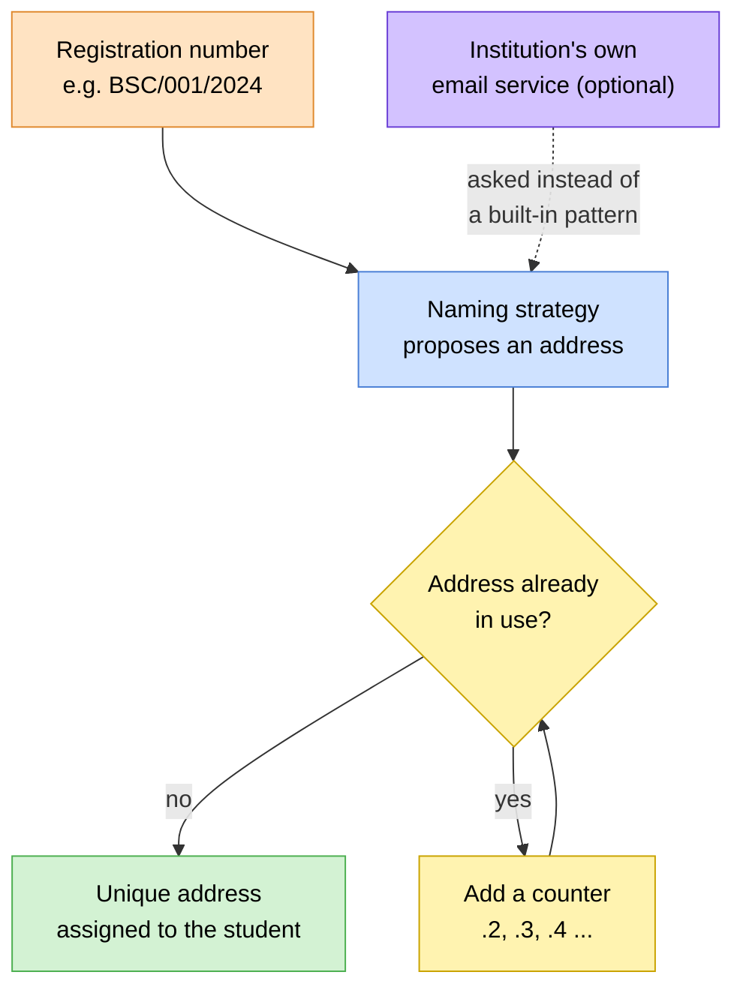

# 📧 Email Address Generation

> How the portal creates an institutional email address for each student from
> their registration number: the naming pattern, how clashes are resolved, and
> how an institution can plug in its own rules or its own email system.
> Think of this as the naming desk: one place that decides what a student's
> address looks like.

> 🕒 Last updated: 2026-10-16

---

## 🗺️ At a Glance

Every student gets an institutional address such as `bsc001@university.ac.ke`.
Two things decide it: the institution's **domain** and a **naming strategy**
that turns a registration number into the part before the `@`. The strategy
only proposes a name. The portal then makes sure it is not already taken.



The strategy never checks for duplicates and never saves anything. Those jobs
belong to the portal, so every naming pattern gets the same guarantees.

---

## 🏷️ Naming Strategies

The institution chooses one strategy for the whole system.

| Strategy              | Idea                                                                               |
| --------------------- | ---------------------------------------------------------------------------------- |
| **Default**           | Built directly from the registration number, with the separators removed           |
| **Initials and year** | A variant built from the programme initials and the year                           |
| **Numeric only**      | Built from the numeric part of the registration number                             |
| **Institution's own** | A custom pattern written for the institution, loaded by its location in the system |
| **External service**  | The portal asks the institution's own email system to generate the address         |

Whatever the strategy, the domain always comes from the institution's
settings. A strategy never hardcodes it.

### Using the institution's own email system

Some institutions already have an identity or email platform that decides
addresses. The portal can ask that system to generate each one. The request
settings (address, method, access credentials and a timeout, 5 seconds by
default) are configured once. If the external service can't be reached, the
portal falls back to a local pattern so enrollment is never blocked by an
outage, and the result is marked as a fallback.

---

## 🔁 Resolving Clashes

Two students can end up with the same proposed address, for example when two
registration numbers differ only in separators. Before an address is assigned,
the portal checks whether it is already in use. If it is, a counter is added
until a free one is found:

```
bsc001@university.ac.ke  →  bsc001.2@university.ac.ke  →  bsc001.3@university.ac.ke ...
```

The first student keeps the plain address. Later ones get the suffix.

---

## 🛡️ Rules Every Strategy Follows

| Rule                          | Why it matters                                                                                                                                 |
| ----------------------------- | ---------------------------------------------------------------------------------------------------------------------------------------------- |
| Addresses are lowercase       | Email addresses are case-insensitive, but the database compares text exactly. Lowercase prevents `CS001@x.com` and `cs001@x.com` both existing |
| Nothing is saved              | A strategy only proposes. The student record is written elsewhere                                                                              |
| Failures are results          | A strategy that can't produce an address says so with a message instead of crashing                                                            |
| The domain is always supplied | One institution-wide setting, so a domain change needs no strategy changes                                                                     |

When a strategy fails and no fallback is available, creating the address stops
with a clear error naming the registration number, and nothing is half-saved.

---

## ⚙️ Configuration

An institution sets two things once:

- **Domain**: for example `university.ac.ke`. If none is set, the portal uses
  a placeholder domain, so set this before going live.
- **Strategy**: one of the built-in names, a custom pattern, or the settings
  for an external service.

If the chosen strategy can't be loaded, the portal falls back to the default
pattern rather than failing to start.

---

## 🔗 Where to Go Next

| Topic                               | Document                                   |
| ----------------------------------- | ------------------------------------------ |
| 🔄 How a student record is created  | [Workflows §1](../../workflows.md)         |
| 🔔 Messages sent to a new student   | [Notifications](../notifications/index.md) |
| 🗃️ Where student details are stored | [ER Diagram §6](../../er-diagram.md)       |

---

> 🔗 Back to [Documentation Index](../../README.md)
