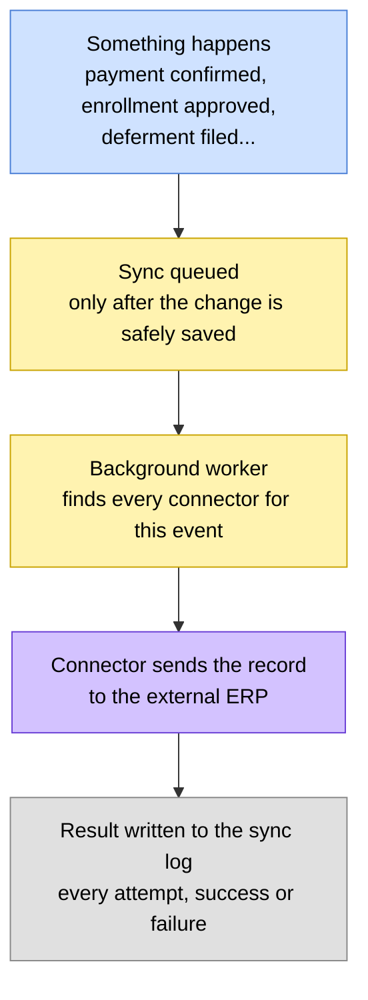

# 🔌 ERP Integration

> How changes inside the portal (a payment clearing, an enrollment getting
> approved, a deferment being filed) are pushed out to whatever external ERP
> the institution runs on.
> Think of this as the outbox: asynchronous, retrying, fully audited, and
> indifferent to which ERP is on the other end.

> 🕒 Last updated: 2026-10-16

---

## 🗺️ At a Glance

The portal never talks to your ERP in the middle of a user's request. When
something worth syncing happens, it queues a job, lets the request finish, and
lets a background worker handle delivery, retries and logging. A slow or flaky
ERP never slows down a student.

A sync is only queued once the change has been committed, so the ERP never
hears about something that was rolled back.

---

## 🔄 The Sync Lifecycle

Every attempt gets its own entry in the sync log, so you can see exactly what
happened without digging through server logs.

| Status       | Meaning                                                                |
| ------------ | ---------------------------------------------------------------------- |
| `attempting` | The portal is about to send the record                                 |
| `success`    | The ERP accepted it                                                    |
| `failed`     | The ERP answered but rejected it, an expected "no"                     |
| `error`      | Something went wrong in transit (timeout, connection error, bad reply) |
| `exhausted`  | Every retry was used up without success; the portal stops trying       |

A rejection and an unexpected error are treated the same way: both are logged
and both trigger a retry.

### Retries

Failed syncs are retried automatically, with the wait **roughly doubling after
each attempt** until it reaches a ceiling. By default a sync gets 5 retries,
starting at a 60-second wait and capped at one hour. An integration can
choose different values if its ERP needs a longer window or fewer attempts.

Each connector has its **own independent retry cycle**. If one integration
gives up, others bound to the same event are unaffected.

---

## 🧾 What the Sync Log Records

| Detail       | Purpose                                             |
| ------------ | --------------------------------------------------- |
| Record       | Which record was synced, such as a specific payment |
| Event        | The event that triggered the sync                   |
| Connector    | Which integration handled it                        |
| Attempt      | Which retry this entry represents                   |
| Status       | One of the five states above                        |
| Message      | A readable result or error                          |
| External ref | The ID the ERP gave back, if any                    |
| Raw response | The ERP's full reply, kept for debugging            |

---

## 🔗 Events

Events follow a `model.action` naming pattern so integrations stay
predictable.

| Domain     | Example events                                                   |
| ---------- | ---------------------------------------------------------------- |
| Financial  | `payment.confirmed`, `payment.failed`                            |
| Academic   | `enrollment.approved`, `enrollment.rejected`, `result.published` |
| Lifecycle  | `deferment.created`, `deferment.reinstated`, `student.graduated` |
| Regulatory | `reporting.submitted`                                            |

Several connectors can listen to the same event, and each one runs
separately. Event names are matched exactly, so a mistyped event name means a
connector simply never fires.

---

## 🔌 Connectors

An integration with a particular ERP is a self-contained **connector**. It
owns one thing: talking to the external system for a given event. Everything
around it is handled by the platform:

- queuing, retries and backoff,
- the sync log and its statuses,
- finding the right connectors for an event.

Adding or changing a connector doesn't touch core portal behaviour, and the
portal doesn't care which ERP product sits on the other end.

---

## 🧪 Safe Testing

You don't need a real ERP sandbox to build an integration. In development
mode, outbound calls are redirected to a local capture server instead of the
real ERP, keeping the original path so requests can still be told apart. You
see every call exactly as it would have been sent, headers and body included,
without any risk of writing to a production system.

---

## 🚦 Principles

**1. A connector only talks to the external API.**
All sync-log entries and retry decisions belong to the platform.

**2. Rejections and errors both retry.**
Whether the ERP says no or the connection drops, the same backoff applies.

**3. The record is looked up when the sync runs, not when it's queued.**
A queued sync survives a worker restart and always sends the current state.

**4. Nothing is sent for an uncommitted change.**

**5. Retry limits are per integration.**

---

## 🔗 Where to Go Next

| Topic                         | Document                        |
| ----------------------------- | ------------------------------- |
| 📰 News module (same pattern) | [News Module](news.md)          |
| 💳 Payments module            | [Payments Module](payments.md)  |
| 🎯 Result publishing          | [Grading & Results](grading.md) |

---

> 🔗 Back to [Documentation Index](../README.md)
