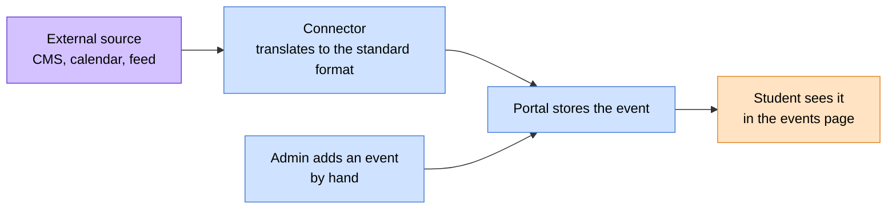

# 🎉 Events

> How university events get from wherever they live (a CMS, a calendar
> service, a spreadsheet, a webhook) into the student portal.
> The portal doesn't care where an event comes from, only that it arrives in
> a standard shape.

> 🕒 Last updated: 2026-10-16

---

## 🗺️ At a Glance

Events follow the same pluggable pattern as news and payments. Each external
source has a **connector** that reads its events and translates them into one
common format. The portal then stores and shows them the same way, whatever
the source.

---

## 🔄 How Events Arrive

| Mode       | When it applies                                       | What happens                                                                                  |
| ---------- | ----------------------------------------------------- | --------------------------------------------------------------------------------------------- |
| **Synced** | A connector is set up and background jobs are running | Events are pulled on a schedule (every 30 minutes by default) and stored. Fast and searchable |
| **Live**   | A connector is set up but nothing has been stored yet | The page fetches events from the source on each visit. Slower, but needs no setup             |
| **Manual** | No connector at all                                   | An administrator adds events directly. Students see them exactly like synced ones             |

The portal switches between these on its own. No configuration flag is
needed.

A source can also **push** changes the moment they happen, through a secured
webhook. Pushed changes are checked before they're accepted.

---

## 📅 What an Event Holds

| Detail                       | Notes                                               |
| ---------------------------- | --------------------------------------------------- |
| Title, description, category | The basics                                          |
| Date, start and end time     | Times are optional (all-day events are fine)        |
| Location                     | A venue, or marked as online                        |
| Meeting link                 | For online events (Zoom, Teams, Meet and so on)     |
| Badge and thumbnail          | Optional highlight and image for the card           |
| Details link                 | Where the full event page lives                     |
| RSVP link and deadline       | Optional; RSVP closes automatically at the deadline |

Two values are worked out automatically and shown the same way everywhere:

- **Status**: upcoming, ongoing or past.
- **RSVP open**: whether the deadline hasn't passed.

---

## ❌ Cancellations

If a source cancels an event, the portal **unpublishes** it instead of
deleting it. Students stop seeing it, but the record stays in the admin
history, so there's always a trail of what was announced.

---

## 🏫 Manual Events

An institution with no CMS can create events straight from the admin area.
Manually created events are labelled so they can never collide with events
that arrive later from a connector.

---

## 🚦 Principles

**1. Connectors translate, the portal stores.**
A connector only talks to the external source. Everything the portal saves is
saved by the portal.

**2. A failing source never breaks the page.**
If a source is down, the sync records the failure and moves on to the next
one. Students keep seeing what was already stored.

**3. Every event keeps a stable identity from its source.**
That is how the same event is updated in place rather than duplicated.

**4. Cancelled means hidden, not erased.**

---

## 🔗 Where to Go Next

| Topic                                 | Document                              |
| ------------------------------------- | ------------------------------------- |
| 📰 News (same pattern)                | [News](../news/index.md)              |
| 💳 Payments                           | [Payments](../payments/index.md)      |
| 🗃️ Where events sit in the data model | [ER Diagram §16](../../er-diagram.md) |

---

> 🔗 Back to [Documentation Index](../../README.md)
