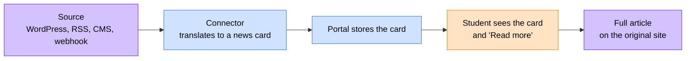

# 📰 News

> How university news and announcements get from wherever they live (a
> WordPress site, an RSS feed, a custom CMS, a webhook push) into the student
> portal. Think of this as the bulletin board: pluggable, institution-agnostic
> and honest about what it does and doesn't store.

> 🕒 Last updated: 2026-10-16

---

## 🗺️ At a Glance

The portal isn't a CMS and doesn't try to replace your university's news
site. It shows students the headlines, with a link back to wherever the full
article lives.

The portal stores **card data only**: title, short summary, category, date,
optional badge and thumbnail, and the link to the full article. It never
copies the article body, which keeps the system simple and keeps ownership of
the content with the publisher.

---

## 🔄 How News Arrives

| Mode       | When it applies                                       | What happens                                                               |
| ---------- | ----------------------------------------------------- | -------------------------------------------------------------------------- |
| **Synced** | A connector is set up and background jobs are running | News is pulled every 30 minutes by default and stored. Fast and searchable |
| **Live**   | A connector is set up but nothing is stored yet       | The page fetches headlines from the source on each visit                   |
| **Manual** | No connector                                          | An administrator posts notices directly. Students see them like any other  |

The portal falls back from synced to live on its own when it has nothing
stored. A source can also push new articles instantly through a secured
webhook, and for scheduled pull only the webhook can be skipped entirely.

---

## 🃏 What a Card Holds

| Detail           | Notes                                                        |
| ---------------- | ------------------------------------------------------------ |
| Title            |                                                              |
| Summary          | One to three sentences: enough for the card, not the article |
| Category         | For example Achievement, Academic, Sports                    |
| Date             |                                                              |
| Source link      | **Required.** Where "Read more" goes                         |
| Source name      | Which feed it came from                                      |
| Badge, thumbnail | Optional highlights                                          |

The source link is what makes the module institution-agnostic. One school
can point to WordPress, another to a custom CMS, another to a PDF notice.
An article with no link is a dead end, so a source's homepage is used as a
fallback when it doesn't supply one.

---

## 🚦 Principles

**1. Connectors translate, the portal stores.**

**2. A failing source never breaks the page.**
If the CMS is down, the failure is logged and the sync moves on.

**3. Cards, not articles.**
Summaries stay short and the full text stays at its source.

**4. Each article keeps the source's own identifier.**
Fetching the same article twice updates the existing card instead of creating
a duplicate. If a source changes its identifiers, cards can duplicate, so
stable IDs are preferred over page slugs.

**5. Pushed articles are verified.**
A webhook has to prove it comes from the configured source before anything is
accepted.

---

## 🔗 Where to Go Next

| Topic                    | Document                           |
| ------------------------ | ---------------------------------- |
| 🎉 Events (same pattern) | [Events](../events/index.md)       |
| 🔌 ERP integration       | [ERP Integration](../erp/index.md) |
| 💳 Payments              | [Payments](../payments/index.md)   |

---

> 🔗 Back to [Documentation Index](../../README.md)
