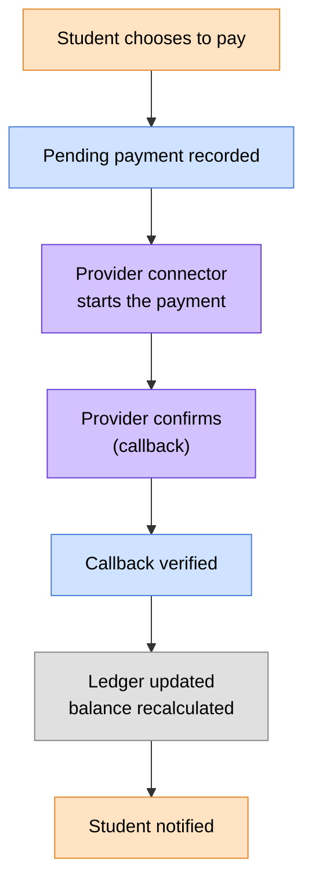

# 💳 Payments

> How money moves through the portal: how providers plug in, what a student
> sees when they pay, and how the ledger stays clean whichever provider an
> institution uses.
> Think of this as the contract between the payment world and the ledger
> world.

> 🕒 Last updated: 2026-10-16

---

## 🗺️ At a Glance

Payments are **pluggable by design**. The portal doesn't care whether a
student pays by M-Pesa, bank transfer, cash or a provider that doesn't exist
yet. Each one is a connector that follows the same contract.

Three parts, each with one job:

- the **payment screen** knows nothing about any provider,
- a **connector** knows nothing about the ledger,
- the **payment service** is the only part that knows both.

---

## 🔌 How a Student Pays

The connector decides which kind of experience the student gets, and the
payment screen adapts automatically.

| Flow       | What the student sees                                          | Example                    |
| ---------- | -------------------------------------------------------------- | -------------------------- |
| `stk_push` | A prompt on their phone; the screen waits until it's confirmed | M-Pesa                     |
| `redirect` | They're taken to the provider's secure page to complete it     | Bank portal                |
| `manual`   | Recorded straight away                                         | Cash at the finance office |

Each connector also describes the fields it needs (a phone number, an account
number) and the instructions to show, so a new provider appears in the payment
screen without any screen changes.

---

## 🔄 After the Provider Responds

1. The provider calls back with the outcome.
2. The callback is **verified** (it must really come from the provider).
3. The payment service matches it to the pending payment using the provider's
   reference.
4. The payment is confirmed, a journal entry is posted, and the student
   account balance is recalculated.
5. The student gets an email and SMS. See [Notifications](../notifications/index.md).
6. Confirmed payments can be passed on to the institution's ERP. See
   [ERP Integration](../erp/index.md).

If the provider rejects the request or can't be reached, the student is told
and the pending payment stays unconfirmed. Nothing is posted to the ledger.

---

## 🚦 Principles

> These keep the audit trail trustworthy.

**1. Connectors never touch the ledger.**
They talk to the provider and report what they learned. Only the payment
service changes balances and records.

**2. A failure is a result, not a crash.**
If a provider is down, the connector reports a failed attempt. The service
decides what happens next.

**3. Every callback is verified before it is believed.**
A forged confirmation can't credit an account.

**4. The reference ties everything together.**
The reference given when a payment starts must match the one in the
provider's callback. That is how the right payment is confirmed.

**5. Balances are derived.**
An account balance is always calculated from payments, charges, scholarships
and refunds, never typed in.

---

## 🔗 Where to Go Next

| Topic                            | Document                                   |
| -------------------------------- | ------------------------------------------ |
| 🔔 Messages sent after a payment | [Notifications](../notifications/index.md) |
| 🔌 Syncing payments to an ERP    | [ERP Integration](../erp/index.md)         |
| 🔄 Fee billing flow              | [Workflows §4](../../workflows.md)         |
| 🗃️ Finance data model            | [ER Diagram §9](../../er-diagram.md)       |

---

> 🔗 Back to [Documentation Index](../../README.md)
