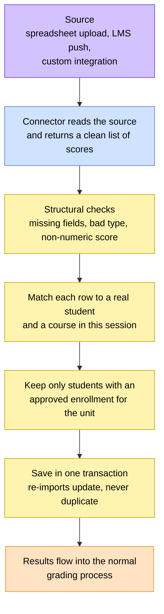

# 📊 Results Import

> How exam and CAT scores get from wherever they're produced (a lecturer's
> spreadsheet, a push from a learning system like Moodle or Canvas, a custom
> grading tool) into the portal. The way scores arrive can change; how they're
> checked and saved doesn't.
> Same pattern as news and ERP: a connector reads and translates, and the
> portal alone writes to the records.

> 🕒 Last updated: 2026-10-16

---

## 🗺️ At a Glance

A connector never touches the database. It only turns whatever shape the
source is in into a standard list of scores. Everything after that, matching
students, checking enrollment and writing, happens in one place no matter
which connector supplied the data.

---

## 🧰 Supported Sources

| Source             | Input                      | Notes                                                                                                                          |
| ------------------ | -------------------------- | ------------------------------------------------------------------------------------------------------------------------------ |
| Spreadsheet upload | An Excel file              | One row per score: registration number, course code, result type, score and a label. The sheet and header row are configurable |
| LMS push           | A JSON message from an LMS | Designed for a results endpoint; reads a list of scores from the request                                                       |

Which source is active is a configuration choice, so switching sources
doesn't touch the rest of the pipeline.

---

## 📝 What One Score Holds

| Detail              | Notes                                   |
| ------------------- | --------------------------------------- |
| Registration number | Identifies the student                  |
| Course code         | Identifies the unit for the session     |
| Result type         | `C` for a CAT, `E` for an exam          |
| Score               | A number such as `68.50`                |
| Title               | A label such as "CAT 1" or "Final Exam" |

---

## 🔁 What Happens on Import

1. **Load**: the connector reads the source for the chosen session.
2. **Validate**: structural problems such as a missing field, an unknown
   result type or a non-numeric score stop the import before anything is
   saved.
3. **Resolve**: each row is matched to a student by registration number and
   to a unit by course code for that session.
4. **Authorise**: only students with an **approved enrollment** for the unit
   receive a score. Everything else is skipped with a warning.
5. **Write**: surviving rows are saved together in one transaction. Importing
   the same file again updates existing results instead of creating copies.

The outcome reports how many results were created and how many rows were
skipped.

---

## ⚠️ Warnings vs Failures

| Situation                                      | Treated as                                    |
| ---------------------------------------------- | --------------------------------------------- |
| A student or course in the file can't be found | Warning: that row is skipped, the rest import |
| A student isn't approved for the unit          | Warning: the row is skipped                   |
| A row is malformed                             | Warning: the row is skipped                   |
| The whole file or payload is unreadable        | Failure: nothing is imported                  |

A few unmatched rows in a spreadsheet of hundreds never block everyone
else's results from landing.

---

## 🚦 Principles

**1. Connectors translate, the portal writes.**

**2. Unreadable input fails; individual bad rows warn.**

**3. Scores are never silently changed.**
If a score looks out of range it is flagged and passed through as it came.
Deciding what to do about it is for a reviewer, not the importer.

**4. Only approved enrollments receive results.**
A score for a unit the student wasn't approved to take is skipped, never
quietly saved.

**5. Imports are repeatable.**
Running the same import twice gives the same records.

Imported scores then follow the same release rules as any other result. See
[Grading & Results](../academics/index.md).

---

## 🔗 Where to Go Next

| Topic                                  | Document                                   |
| -------------------------------------- | ------------------------------------------ |
| 🎯 How scores become grades            | [Grading & Results](../academics/index.md) |
| 🔄 Result approval flow                | [Workflows §14](../../workflows.md)        |
| 🔌 Pushing published results to an ERP | [ERP Integration](../erp/index.md)         |

---

> 🔗 Back to [Documentation Index](../../README.md)
