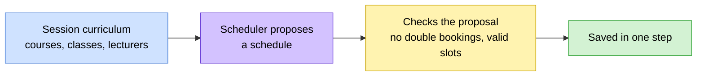

# 🗓️ Timetabling

> How classes get scheduled, how exams get scheduled, and how a different
> scheduling method can be swapped in for either one without touching the rest
> of the system.
> Think of this as the engine room: most students never see it, but
> everything breaks without it.

> 🕒 Last updated: 2026-10-16

---

## 🗺️ At a Glance

Timetabling has two separate concerns, each with its own scheduler:

| Concern              | Answers                                                               |
| -------------------- | --------------------------------------------------------------------- |
| **Weekly timetable** | Which class takes which course, on which day, in which slot and venue |
| **Exam timetable**   | Which unit is examined, when, where, and who invigilates              |

In both cases a scheduler **proposes** a schedule, the proposal is checked,
and only then is it saved.

The default scheduler is a **greedy, slot-by-slot** method. It isn't trying to
be optimal. It aims to be correct, fast and replaceable. An institution that
needs a smarter method (an optimisation solver, say) can switch to one
through configuration, with no other changes.

---

## 🧱 What Gets Scheduled

| Item            | Holds                                                                                 |
| --------------- | ------------------------------------------------------------------------------------- |
| Timetable entry | One class, one slot, one venue, for a curriculum entry                                |
| Exam sitting    | A curriculum entry, an exam type (Main, Supplementary or CAT), a date and a time slot |
| Exam venue      | One hall used by a sitting, with its own invigilator                                  |
| Exam clash      | A student who ended up with two exams at the same date and time                       |

An exam can span several venues, for example when a large cohort is split
across halls, and each venue gets its own invigilator. Lecturers belong to
the curriculum entry rather than to the timetable entry.

The days and slots on offer are set by the institution, for example Monday to
Friday with two-hour teaching slots.

---

## 📅 The Weekly Schedule

The scheduler places each curriculum entry in the first day, slot and venue
that satisfies every hard rule.

| Rule                                                                     | Kind |
| ------------------------------------------------------------------------ | ---- |
| The lecturer isn't already booked at that day and slot                   | Hard |
| The class isn't already booked at that day and slot                      | Hard |
| The venue isn't already booked at that day and slot                      | Hard |
| A common unit is placed at a time when every class that takes it is free | Hard |
| No class has more than 3 slots on one day                                | Soft |

### Common units

A **common unit** is the same course taken by several classes at once.
Ordinary courses are placed first. Common units go last, because they need a
slot where every lecturer and every class involved is free together, with
each class getting its own venue.

### When something can't be placed

If an entry can't be placed at all, the run **fails with a message naming the
exact course and class**, and nothing partial is saved. A soft rule being
stretched, such as a busy day for a class, is recorded as a warning and does
not block saving.

---

## 📝 The Exam Schedule

The exam scheduler first gathers everything it needs (candidate dates,
venues, invigilators, and which students and lecturers belong to each unit)
and then works only from that.

| Rule                                                          | Kind |
| ------------------------------------------------------------- | ---- |
| A class isn't sitting two exams at the same date and slot     | Hard |
| No student has two exams at the same date and slot            | Hard |
| A venue isn't used twice at the same date and slot            | Hard |
| An invigilator isn't assigned twice at the same date and slot | Hard |

- **Date window**: exam dates are weekdays only, counted from 14 days before
  the session's end date.
- **Invigilators**: the unit's own lecturers are preferred, since they know
  the material and the students. Any free lecturer is used only if none of
  them can make that slot.
- **Clash check**: once a schedule exists, a separate check finds any student
  who still has two exams at once and records them for review.

### All or nothing

Unlike the weekly timetable, **the exam scheduler saves nothing if even one
exam can't be placed**. The whole run has to succeed cleanly or none of it
lands. It's worth sizing venues and invigilator pools before running a full
session.

---

## ⚠️ Before Running a Schedule

| Check                                            | What happens if it's missing                                                         |
| ------------------------------------------------ | ------------------------------------------------------------------------------------ |
| Every curriculum entry has at least one lecturer | The run stops and names the course and class                                         |
| At least one venue exists                        | The run stops immediately                                                            |
| Enough venues, slots and invigilators            | A dense curriculum can run out of options. The message names what couldn't be placed |

When a greedy run can't finish, the usual fixes are adding venues, loosening
soft rules, or switching to a smarter method.

### Regeneration replaces the schedule

Running a schedule **clears the existing records for that session** and
writes the new ones in one step. Hand-made adjustments should be made after
generating, not before, because the next run replaces them.

---

## 🚦 Principles

**1. Schedulers propose, they never save.**
Each part has a single place that writes to the database.

**2. Ordinary scheduling problems are results, not crashes.**
"Couldn't place this course" comes back as a clear message. Real exceptions
are reserved for the unexpected.

**3. Hard rules fail the run, soft rules warn.**
In the exam scheduler any warning also blocks saving.

**4. Regeneration is destructive by design.**

**5. Validate before writing.**
Illegal days or slots and internal double bookings are caught before anything
is saved.

---

## 🔗 Where to Go Next

| Topic                                     | Document                                   |
| ----------------------------------------- | ------------------------------------------ |
| 🔄 Exam coordination, clashes and cards   | [Workflows §9](../../workflows.md)         |
| 🗃️ Scheduling data model                  | [ER Diagram §10–11](../../er-diagram.md)   |
| 🗓️ Session dates and registration windows | [Grading & Results](../academics/index.md) |

---

> 🔗 Back to [Documentation Index](../../README.md)
