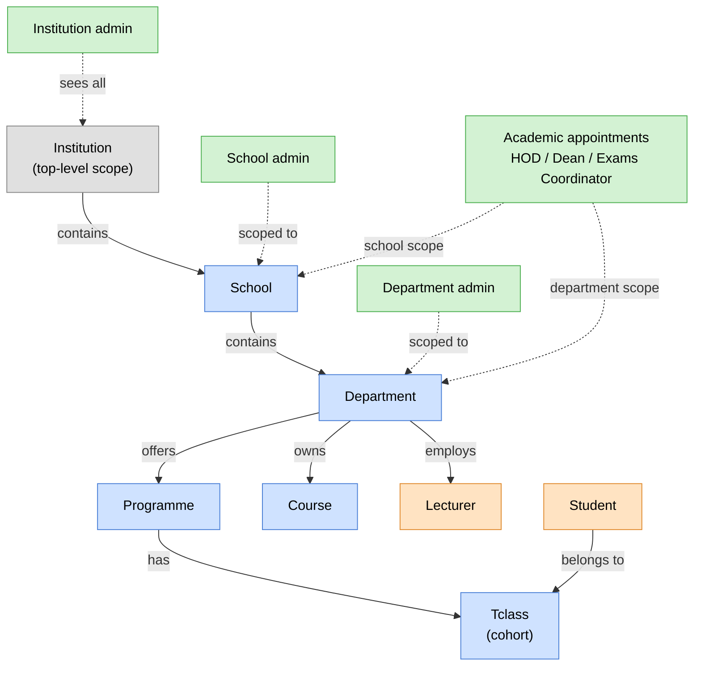
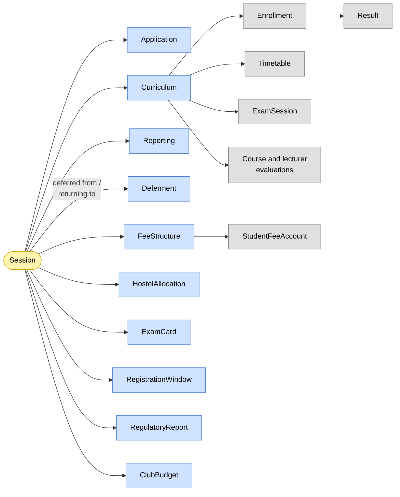
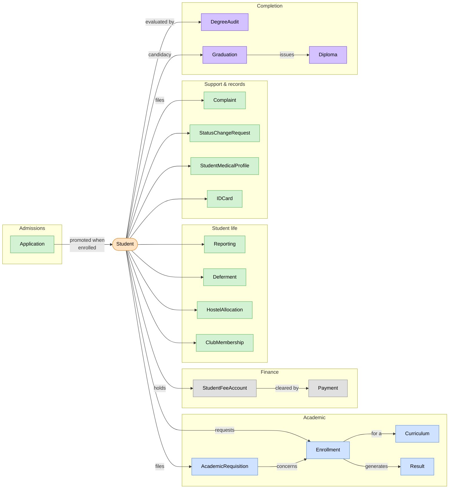
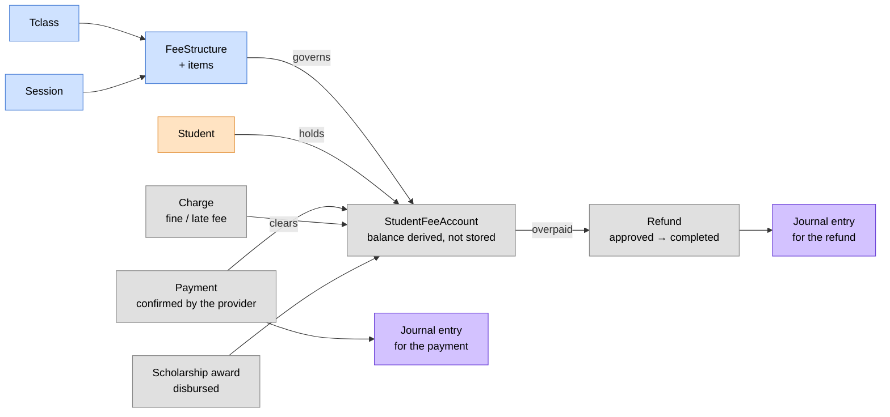

# 🗺️ System Overview

> A high-level sketch of how everything in the system connects:
> who owns what, what flows where, and how the pieces fit together.
> Read this before diving into the details.

> 🕒 Last updated: 2026-10-16

---

## 1. Institutional hierarchy & access scope

Solid arrows are ownership; dashed arrows show which level each admin or
appointment is scoped to. `Institution` is the top-level scope only. It is
not an entity in the ER diagram.

Every student traces back through class, programme, department and school.
This chain is what makes **scoped access** possible: a School Admin sees only
their school's data, a Department Admin only their department's. Admin roles
are assigned the matching permissions automatically when a user is created.

---

## 2. Session anchors the data

Almost everything time-bound hangs off a `Session`. Blue entities link to it
directly; grey ones reach it through the entity they hang off.

There is only ever **one active session** institution-wide. When a session
rolls over, curriculum is cloned and the new session becomes the single
source of truth for new activity.

---

## 3. The student at the centre

**📋 Enrollment**: an explicit `Enrollment` record links a `Student` to a
`Curriculum` entry (course + class + session). Core and Common units are
enrolled automatically on registration; electives are registered manually and
need HOD or lecturer approval.

**🎯 Results**: scores become grades through one set of rules. See
[Grading & Results](modules/academics/index.md).

**💰 Fees**: see §4.

**🎓 Completion**: published results feed degree audit; an eligible student
moves to graduation, then diploma and convocation.

---

## 4. Fee flow

What a student owes is derived from their **class** and the session, never
hardcoded. The balance is computed from payments, charges, awards and refunds.

---

## 🔗 Where to Go Next

| Topic                         | Document                                                     |
| ----------------------------- | ------------------------------------------------------------ |
| 🏗️ Layers & runtime           | [Architecture Overview](architecture.md)                     |
| 🗃️ Full database schema       | [ER Diagram](er-diagram.md)                                  |
| 🔄 Role-based flows           | [Workflows](workflows.md)                                    |
| 🎯 How marks become grades    | [Grading & Results](modules/academics/index.md)              |
| 🗂️ How staff handle cases     | [Case Handling](modules/casework/index.md)                   |
| 🔌 Connecting to an ERP       | [ERP Integration](modules/erp/index.md)                      |
| 👥 Who can access what        | [Actors & Access Matrix](actors.md)                          |
| 🎓 Enrollment deep dive       | [Enrollment Module](modules/enrollment/index.md)             |
| 💰 Fee processing deep dive   | [Fees Module](modules/fees/index.md)                         |
| 🔄 Session rollover deep dive | [Session Rollover Module](modules/session-rollover/index.md) |

---

> 🔗 Back to [Documentation Index](README.md)
