# 🔄 Role-Based Workflows

> How each role moves through the system, one flowchart per domain.
> Diamonds are decision or approval gates.

> 🕒 Last updated: 2026-10-16

---

## 1. Student Lifecycle (cross-role, end to end)

The spine everything else hangs off: admission through graduation, with the
roles that touch each stage.

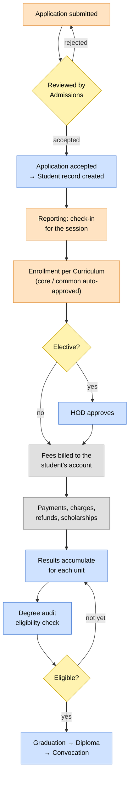

---

## 2. Academic Staffing & Approval

Lecturer → HOD: teaching assignment and elective enrollment approval.
Complaint handling has its own ladder, covered in §3.

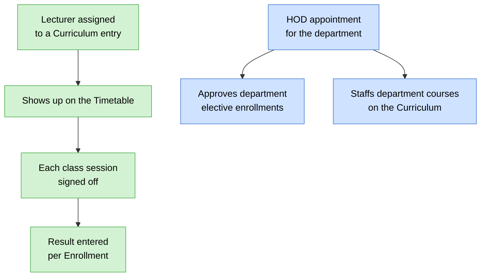

---

## 3. Complaint / Grievance Lifecycle

Each category has its own escalation path and time limits. Levels whose seat
is vacant are skipped automatically. Staff-side handling is described in
[Case Handling](modules/casework/index.md).

### 3.1 Complaint Routing (entry level)

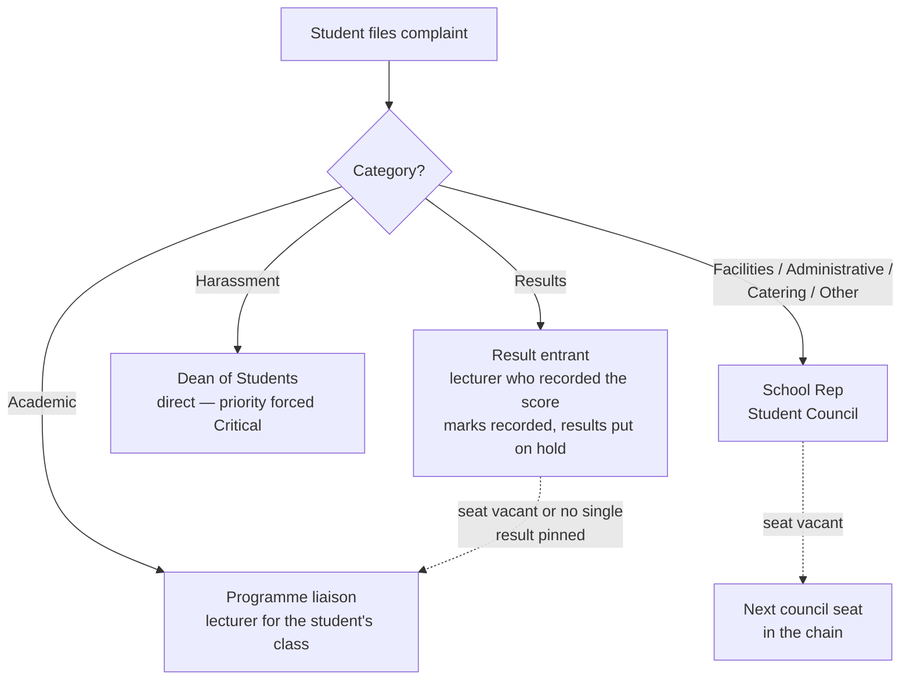

### 3.2 Escalation Ladders & Time Limits

```mermaid
flowchart LR
    subgraph Results["Results track"]
        R1[Result entrant<br/>24h]
        R2[Liaison<br/>48h]
        R3[Department HOD<br/>72h]
        R4[School Dean<br/>72h]
        R5[Registrar Academic<br/>Division 120h]
        R6[Senate<br/>72h]
        R1 --> R2 --> R3 --> R4 --> R5 --> R6
    end

    subgraph Academic["Academic track"]
        A1[Liaison<br/>48h]
        A2[Department HOD<br/>72h]
        A3[School Dean<br/>72h]
        A4[Dean of Students<br/>72h]
        A5[Division<br/>72h]
        A6[Senate<br/>72h]
        A1 --> A2 --> A3 --> A4 --> A5 --> A6
    end

    subgraph Ops["Facilities / Administrative /<br/>Catering / Other track — 24h each"]
        B1[School Rep]
        B2[Secretary General]
        B3[Deputy Chairperson]
        B4[Chairperson]
        B5[Dean of Students]
        B6[Senate]
        B1 --> B2 --> B3 --> B4 --> B5 --> B6
    end

    subgraph Harassment["Harassment track — 12h each"]
        C1[Dean of Students<br/>direct entry]
        C2[Senate]
        C1 --> C2
    end
```

### 3.3 Escalation Trigger

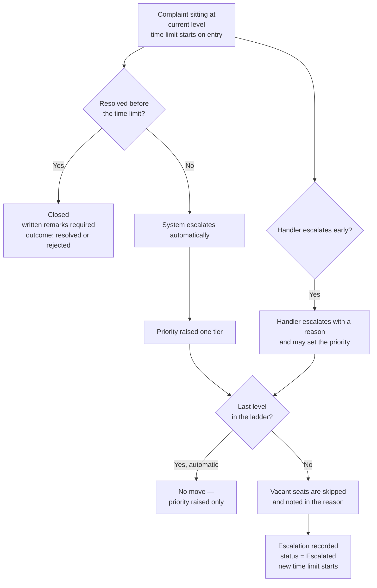

### 3.4 Closure & Appeal

An appeal is allowed only on a closed case, within 14 days, with no appeal
pending, fewer than 2 earlier appeals, and only if the decision was not made
at the final level of the ladder. Grounds must be at least 30 characters.

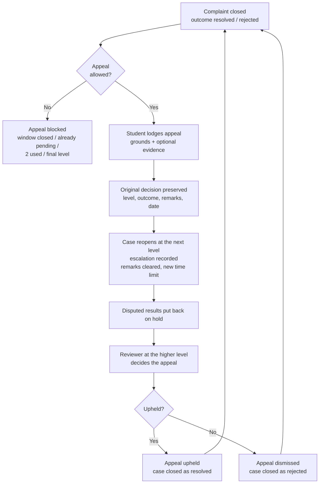

### 3.5 Results Dispute Side-Effects

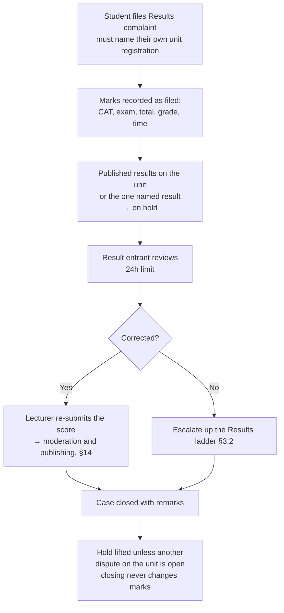

---

## 4. Student Fee Billing & Payment

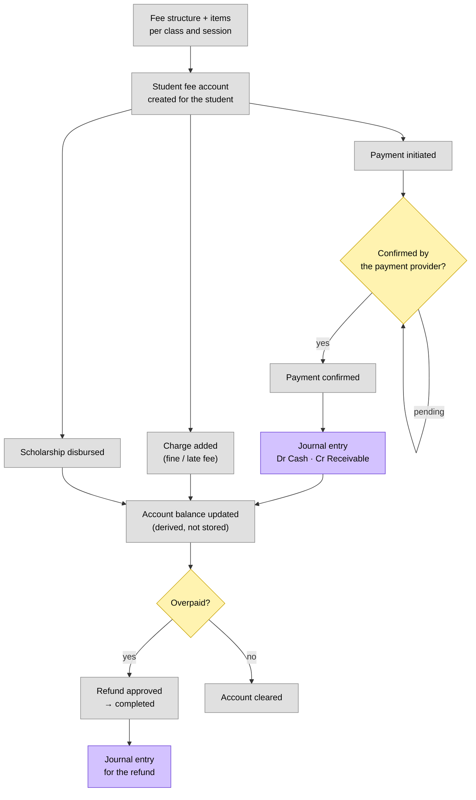

---

## 9. Exams — Coordinator to Director

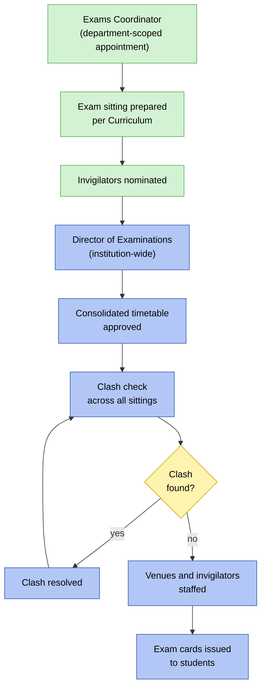

---

## 10. Clubs — Membership to Event

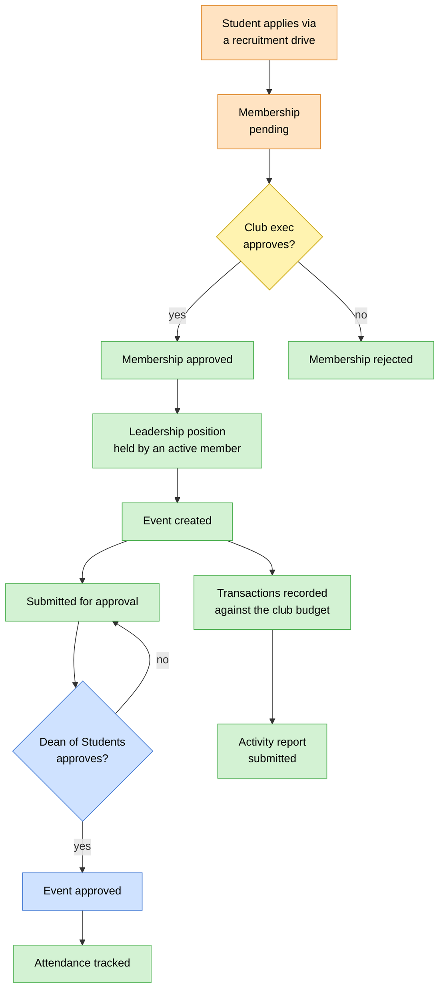

---

## 11. Student Council — Election to Governance

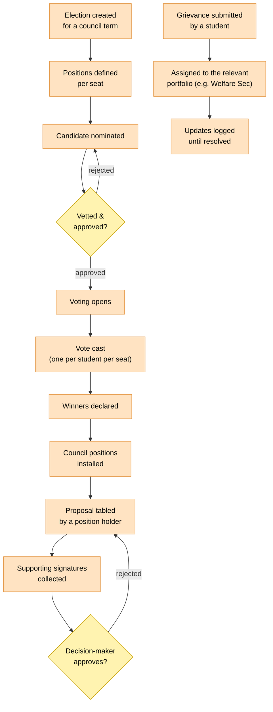

---

## 12. Hostel Allocation

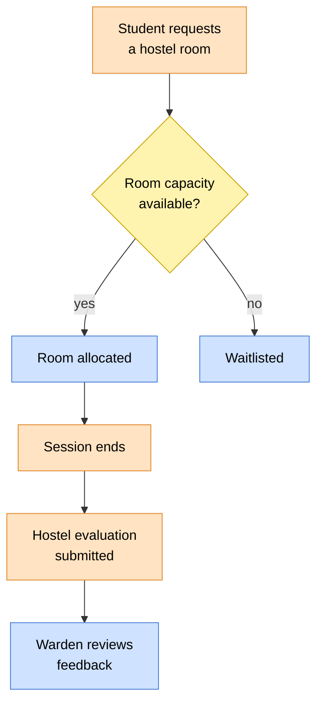

---

## 13. Enrollment

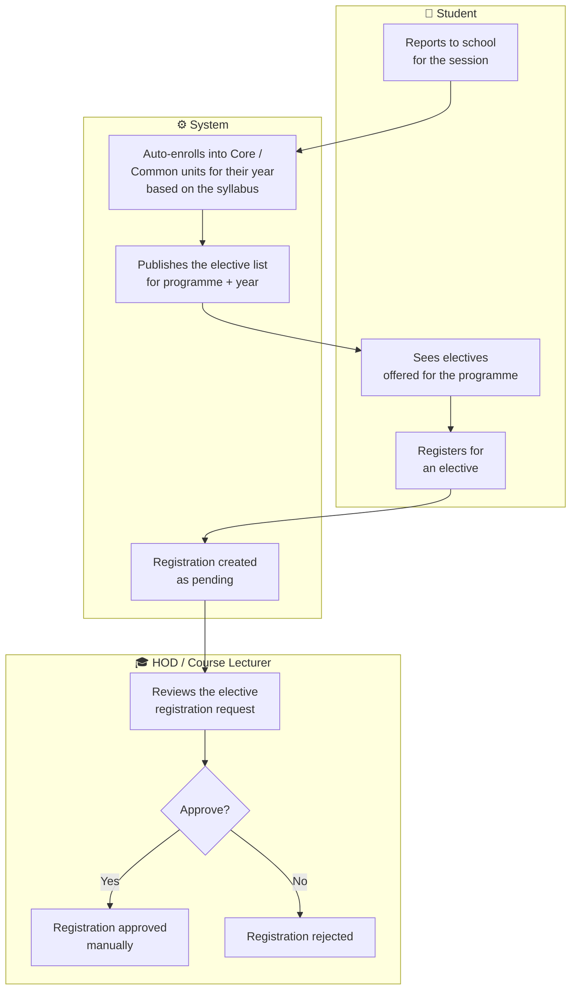

---

## 14. Results

How scores become grades is covered in [Grading & Results](modules/academics/index.md).

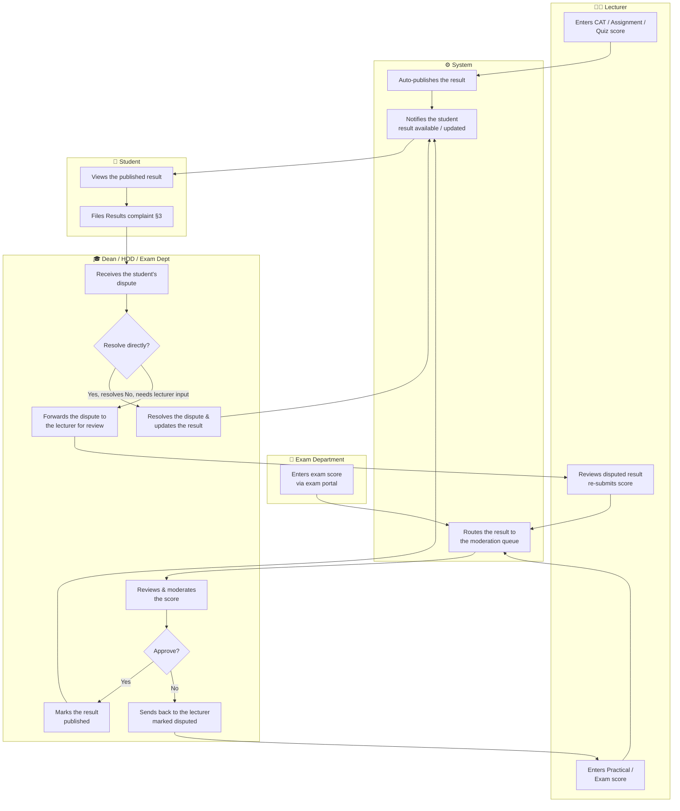

The dispute path in this diagram is driven by a results complaint. See §3.5
for the hold and the recorded marks, and §3.2 for who reviews at each level.

---

## 15. Graduation Track

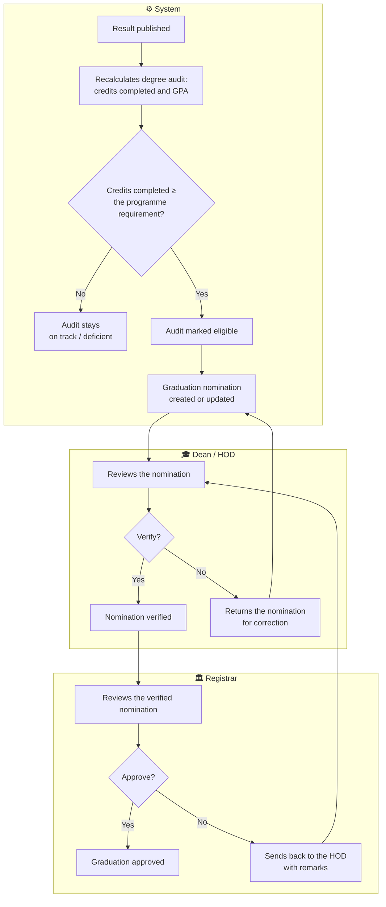

---

## 16. Exam

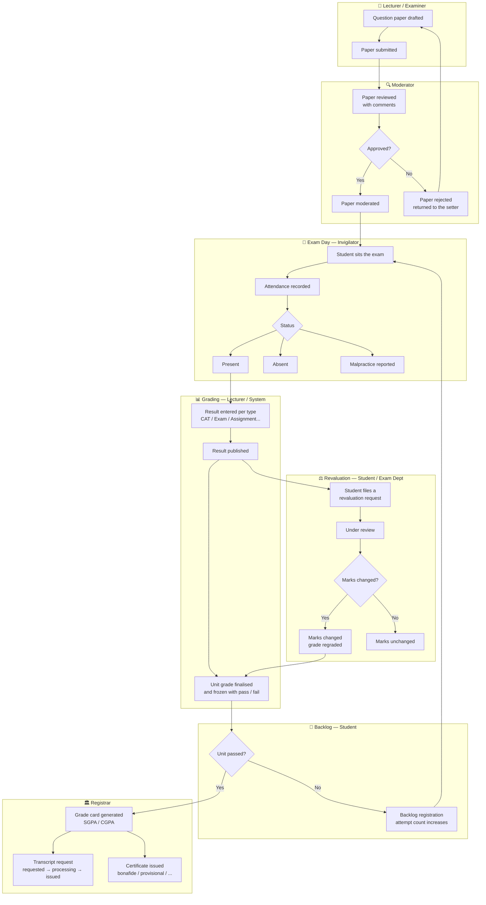

Re-evaluation requests are also handled through academic requisitions, see §17.

---

## 17. Academic Requisitions

Resit, supplementary, special sit-in, missing-marks and re-evaluation
requests. All types go through the same two-stage review (HOD recommendation,
then Registrar decision), followed by optional scheduling and a fee gate
before completion.

### 17.1 Requisition Lifecycle

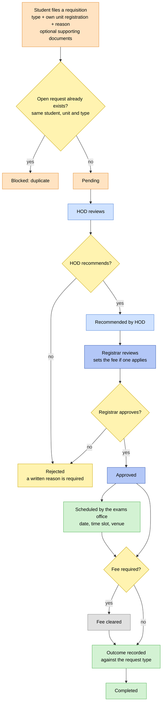

### 17.2 What each type does

| Type          | Needs                                                                                                  | Outcome on completion                                                          |
| ------------- | ------------------------------------------------------------------------------------------------------ | ------------------------------------------------------------------------------ |
| Resit         | Optionally registered against a formal exam sitting                                                    | The result of the new attempt is recorded as the outcome and tagged as a resit |
| Supplementary | Optionally registered against a formal exam sitting                                                    | Same as a resit, tagged as supplementary                                       |
| Special exam  | Nothing extra; scheduled ad hoc                                                                        | The sitting result is recorded and tagged as a special exam                    |
| Re-evaluation | The specific result being remarked, which must belong to the unit and be published or already disputed | The corrected result is recorded, and the request notes whether marks changed  |
| Missing marks | Nothing extra                                                                                          | The investigation closes; any recovered result is recorded as the outcome      |

Rules that apply to every request:

- A student can only file against their own unit registration.
- Only a re-evaluation names a specific result.
- Only resits and supplementaries register against a formal exam sitting.
- A student can have only one open request of the same type per unit.
- A rejection must carry a written reason.
- If a fee applies, an approved request needs the fee amount set, and completion needs the fee cleared.

### 17.3 Planned review routing

Review will later follow the same level-based model as complaints, so that the
result entrant and programme liaison can look at remarking and missing-marks
requests first. See [Case Handling](modules/casework/index.md).

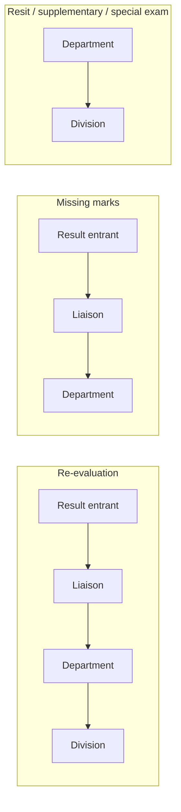

---

> 🔗 Back to [ER Diagram](./er-diagram.md)
> 🔗 Back to [Project Index](../README.md)
